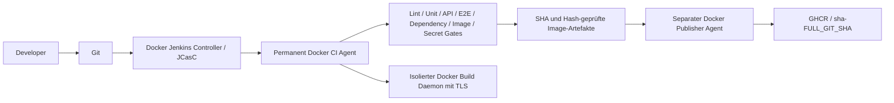

# PHASE 1 RESULT

Stand: 12. Oktober 2026. Scope: Jenkins in Docker, CI, Anwendungstests,
Docker-Images und Security. Kein Terraform Apply, kein Kubernetes Deployment,
kein Production Deployment und kein Registry-Push mit erfundenen Credentials.

## Bewertung

| Bereich | Status | Nachweis / verbleibende Grenze |
|---|---|---|
| Jenkins Docker Setup | PASS | Gepinnter Controller, JCasC, persistentes Home, zwei permanente Docker-Agenten; Live-Prüfung auch nach Controller-Neustart bestanden. |
| Jenkins CI | PARTIAL | Beide Jenkinsfiles durch Jenkins validiert; kompletter CI-Runner lokal getestet. Ein echter Jenkins-SCM-Lauf gegen den geänderten, noch nicht veröffentlichten Quellstand ist nicht nachgewiesen. |
| Backend Tests | PASS | 2 Unit-Tests und 53 API-/Integrationstests; mypy, Ruff und Formatprüfung; Coverage 89 %. |
| Frontend Tests | PASS | Biome, TypeScript/Vite-Build und 41 Playwright-Tests bestanden. Keine eigenständige Frontend-Unit-Suite vorhanden; vorhandene E2E-Tests erhalten. |
| Docker Backend | PASS | Multi-Stage, Digest-Pinning, locked uv Dependencies, Non-Root 10001, Healthcheck und Runtime-Smoke-Test. |
| Docker Frontend | PASS | Multi-Stage, npm ci, Digest-Pinning, nginx Non-Root 101, Healthcheck und Runtime-Smoke-Test. |
| Registry Workflow | PARTIAL | Verifizierte Artefakte, SHA-Tags, separate Publisher-Agentenidentität, sieben Writer-Tests bestanden. Vorhandene GHCR-Credentials sind installiert und Push-Berechtigung bestätigt; tatsächlicher Image-Push wartet auf den veröffentlichten SCM-Stand. |
| Security | PASS | Dependency-, Image- und Secret-Gates bestanden; alle drei Jenkins-Infrastruktur-Images ohne High/Critical-Findings. Historische Demo-Session extern widerrufen, falls sie wider Erwarten noch existiert. |

## Umgesetzte Architektur

Der Controller hat null Executoren und keine Cloud-Agenten. Das Kubernetes-
Agentenplugin und ausschließlich Jenkins dienende Kubernetes-RBAC-Dateien sind
entfernt. Beide permanenten Agenten laufen in Docker. Die Pipeline führt keine
Kubernetes-, ArgoCD-, Terraform- oder Production-Deployment-Befehle aus.

Der Publisher hat weder das Build-Netz noch Docker-TLS-Zertifikate. Er prüft
Jenkins-Build-Ergebnis, SCM-SHA, Gate-Liste und Archiv-Hashes, bevor er
Registry-Credentials verwendet. Ein bestehender SHA-Tag mit anderem Inhalt wird
abgelehnt; derselbe Inhalt kann erneut geprüft werden.

## Behobene Probleme

- Kubernetes-Agenten und Deployment-Aufgaben aus der aktiven Jenkins-Pipeline
  durch Docker-CI und einen getrennten Registry-Publisher ersetzt.
- Jenkins-/Agenten-Images, Tools, Plugins und CI-Service-Images gepinnt;
  Plugininstallation und JCasC automatisiert. Alte Kubernetes-Plugins wurden
  vor der Migration aus dem aktiven Jenkins-Home ausgelagert.
- Jenkins-Home privat gesichert; alte Container für Rückkehr erhalten.
  Controller und Agenten laufen als UID 1000 mit eingeschränkten Capabilities.
- Die Migration hatte zunächst fehlende Backup-Leserechte und überlagerte
  Read-Only-Mounts. Beide Ursachen repariert und Migration erneut erfolgreich
  ausgeführt. Nur der kurzlebige Backup-Container erhält DAC-Leserechte.
- Veraltetes Matrix-Auth-Format durch explizite Benutzer-Einträge ersetzt;
  Erzeugung von Legacy-API-Tokens per JCasC deaktiviert.
- Backend-Abhängigkeiten aktualisiert und uv-Lockfile erneuert;
  Settings-Typfehler, API-Typisierung und falsche Test-Mocks korrigiert.
- Unit-Tests von der automatisch gestarteten Datenbank entkoppelt.
  API-/Integrationstests verwenden eine isolierte, flüchtige Testdatenbank.
- Frontend-Abhängigkeiten einschließlich Router, Generator und Playwright
  aktualisiert; Client-Adapter und Anwendung an die neue API angepasst.
- Deaktivierte Formularbuttons bei Blur-Validierung repariert: User-Anlage,
  Item-Anlage und Passwortänderung validieren jetzt bei Eingabe. Die Tests
  wurden erhalten und anschließend erneut ausgeführt.
- E2E verwendet einen gebauten Vite-Preview-Server, Mailpit und isolierte
  Docker-Dienste. Lokale Auth-Dateien gelangen nicht ins Playwright-Image.
- Backend-/Frontend-Runtime-Images als Non-Root gebaut; Build-Werkzeuge und
  Testdateien aus den Runtime-Images ausgeschlossen; Healthchecks ergänzt.
- Generator verwendet ein eigenes uv-Environment und bei fehlendem npm ein
  gepinntes Node-Docker-Image. Das erzeugte OpenAPI-Schema zählt wie der
  generierte SDK-Code zu Build-Artefakten, nicht zu handgeschriebenen Quellen.
- Dependency-, Container- und Secret-Scanner blockieren die Pipeline bei
  Findings bzw. Ausführungsfehlern; High/Critical sind keine Warnungen.
- Dependabot-Pfade und unterstützende GitHub-Checks aktualisiert; Client-
  Generierung benötigt keinen schreibenden GitHub-PAT mehr.

## Validierung

| Prüfung | Ergebnis |
|---|---|
| Backend mypy / Ruff / Ruff Format | PASS |
| Backend Unit | 2/2 PASS |
| Backend API / Integration | 53/53 PASS |
| Backend Coverage | 89 % |
| Frontend Biome | PASS |
| Frontend TypeScript / Vite Build | PASS |
| Frontend Playwright Chromium | 41/41 PASS |
| Python pip-audit, einschließlich Dev-Abhängigkeiten | Keine bekannten Findings |
| npm audit | 0 Vulnerabilities |
| Gitleaks Working Tree / vollständige erreichbare Historie | PASS nach eng begrenzten geprüften Ausnahmen |
| Backend / Frontend Runtime Build | PASS |
| Backend / Frontend Non-Root Health-Smoke | PASS |
| Backend / Frontend Trivy HIGH,CRITICAL + Secrets | PASS auch im abschließenden vollständigen Lauf |
| Jenkins Controller / Agent Build | PASS |
| Gepatchter DinD Build | PASS |
| Jenkins Controller / Agent / DinD Security | Jeweils 0 High/Critical |
| Aktualisierter Agent: TLS / BuildKit / runc-Seccomp / nginx Health | PASS |
| Playwright Dockerfile Build | PASS |
| Lokale und Jenkins Compose-Konfiguration | PASS |
| Python-/Shell-/YAML-/JCasC-Strukturprüfung | PASS |
| Jenkins Declarative Linter, beide Jenkinsfiles | PASS |
| Live Jenkins: Controller, Agenten, Isolation, Jobs | PASS auch nach Neustart |
| CI-Unit-Tests | 19/19 PASS, davon 7 Registry-Writer-Tests |
| OpenAPI-/SDK-Generierung | PASS |

Die Anwendungstests sind lokal mit echten Docker-Containern ausgeführt worden.
Es wurde kein vollständiger Registry-Push behauptet. Die finalen lokalen
Reports liegen in `.ci-output/`; private Test-Credentials werden aufgeräumt.

## Security vorher / nachher

- npm: zuvor 62 bekannte Findings (3 Critical, 55 High, 4 Moderate), danach 0.
- Python: aktualisierte, gesperrte Dependency-Menge durch pip-audit geprüft;
  anschließend keine bekannten Findings.
- Runtime: zuvor Root-/veraltete Build-Konfigurationen; danach getrennte
  Build-/Runtime-Stages und Non-Root mit Healthchecks. Smoke-Tests starten
  mit `cap-drop ALL` und `no-new-privileges`.
- Secret Scan: initiale Treffer geprüft; SealedSecret-Ciphertext und öffentliche
  Plugin-Koordinaten erhalten nur präzise, dateigebundene Ausnahmen. Drei
  unveränderliche historische Fingerprints betreffen denselben Jupyter-
  Demo-Session-Token in importierter Dokumentation von 2018. Neue Klartext-
  Secrets bleiben blockierend. Kein aktives Projekt-Credential gefunden.
- Historischer Demo-Token: als kompromittiert behandeln. Falls die damalige
  Session noch lebt, am ursprünglichen Dienst widerrufen. Historie wurde nicht
  umgeschrieben; der Wert wird hier nicht ausgegeben.
- DinD bleibt als einziger privilegierter Dienst eine begründete Ausnahme:
  privates TLS-Netz, kein Host-Docker-Socket, keine Kubernetes-/Registry-
  Credentials. Für vertrauenswürdigen Repository-Code auf dediziertem CI-Host.
  Ausführung untrusted Forks benötigt künftig isolierte Wegwerf-Worker.
- Jenkins Controller: zuvor 8 High, anschließend 0 High/Critical durch
  Entfernen des nach der Plugininstallation unnötigen Installers.
- Jenkins Agent: zuvor 47 High und 1 Critical, anschließend 0 High/Critical.
  Unbenutztes git-lfs entfernt; Gitleaks, Crane und Trivy aus checksum-geprüften,
  gepinnten Quellen mit gepatchten Go-Abhängigkeiten gebaut. Die Anwendung
  bleibt Python; Go dient ausschließlich dem Build vorhandener CI-Werkzeuge.
- Docker-Build-Daemon: zuvor 58 High im alten Basisimage, 15 High auch im
  aktuellen unveränderten Basisimage; repariertes Image 0 High/Critical.
  Unbenutzte Werkzeuge entfernt, runc und Containerd-Shim gepatcht gebaut;
  Seccomp-Unterstützung bleibt erhalten.

Details: `infra/jenkins-host/SECURITY.md`.

## Externe Voraussetzungen und verbleibende Grenzen

1. **GHCR-Credential: ERLEDIGT.** Die vorhandenen Docker-GHCR-Credentials
   wurden mit ausdrücklicher Nutzerfreigabe ohne Wertausgabe in Jenkins unter
   `trusted/ghcr-write` übernommen. Backend- und Frontend-Push-Berechtigung wurden durch
   einen leeren Upload geprüft. GHCR unterstützt dessen expliziten Abbruch
   hier nicht (HTTP 405); es wurden keine Blob-Daten oder Image-Manifeste
   veröffentlicht. Kein neues Token erforderlich.
2. **SCM-Stand:** die Phase-1-Änderungen werden auf `setup/dev-gitops` veröffentlicht. Für den
   echten Jenkins-Checkout muss der geprüfte Stand im konfigurierten `main`
   verfügbar sein. Keine Veröffentlichung oder Commit wurde vorgetäuscht.
3. **Historische Session:** ein etwaiger Widerruf am ursprünglichen Dienst
   kann nur mit dortigem Zugriff bestätigt werden.
4. **Reproduzierbarkeit:** Digests, Plugin-/Tool-Versionen und Anwendungs-
   Lockfiles sind festgelegt. OS-Security-Updates aus APK-Repositories sind
   bewusst beim Jenkins-Build enthalten; ohne Repository-Snapshot ist keine
   byteidentische Wiederholung über beliebige Zeiträume garantiert.

Terraform: **DEFERRED**. Production: **DEFERRED**.
Kubernetes/ArgoCD/Monitoring/DB Recovery: **NEXT PHASE**.
Vorhandene Änderungen anderer Phasen im Working Tree sind keine Phase-1-
Änderungen und wurden nicht für diesen Bericht als Implementierung gezählt.

## Dateien

Die vollständige Liste der in Phase 1 betroffenen Dateien steht im folgenden
Anhang. „Neu“ bezeichnet im Git-Working-Tree untracked Dateien; einige Jenkins-
Dateien waren schon vor Phase 1 lokal untracked vorhanden und wurden verbessert.

## Abschließende Validierung

Der vollständige lokale CI-Lauf endete mit Exit-Code 0; alle 18 erforderlichen
Gates und die beiden Archiv-Hashes sind in `.ci-output/gates.json` attestiert.
Diese Prüfung betrifft den lokalen Working Tree, nicht einen veröffentlichten
SCM-Build. Die SHA dort bezeichnet den vorhandenen HEAD und darf nicht als
Nachweis eines bereits veröffentlichten Phase-1-Commits verstanden werden.

Die abschließende separate Prüfung aller drei Jenkins-Images endete ebenfalls
mit Exit-Code 0: Controller, Agent und DinD jeweils 0 High/Critical. JSON-Reports
liegen in `.ci-security/`. Beide permanenten Agents wurden auf das geprüfte
Image aktualisiert. Der erneute Gitleaks-Lauf über Working Tree und erreichbare
Git-Historie bestand; temporäre Testressourcen wurden danach aufgeräumt.
Die abschließende Konfigurationsprüfung und `git diff --check` für den
Phase-1-Scope bestanden. Keine Tests wurden entfernt oder deaktiviert.
Die Live-Verifikation nach dem Agent-Update bestand ebenfalls: beide Agents
online, persistentes Controller-Home, null Controller-Executoren, keine Cloud-
Agents, isolierter Publisher und Docker-Server 29.9.0. Die erste Prüfung direkt
nach dem Start erfolgte vor der Agent-Verbindung; der erneute Lauf bestand.
Ein echter verschachtelter BuildKit-Build und ein Non-Root-nginx-Healthcheck
über Agent-TLS bestanden mit dem gepatchten runc einschließlich Seccomp.

## Dateianhang

### Geändert

- `.github/dependabot.yml`
- `.github/workflows/generate-client.yml`
- `.github/workflows/lint-backend.yml`
- `.github/workflows/playwright.yml`
- `.github/workflows/test-backend.yml`
- `.github/workflows/test-docker-compose.yml`
- `.gitignore`
- `JENKINS-TROUBLESHOOTING.md`
- `JENKINS_RECOVERY_REPORT.md`
- `Jenkinsfile`
- `Jenkinsfile.promote`
- `README-jenkins.md`
- `README.md`
- `backend/.dockerignore`
- `backend/Dockerfile`
- `backend/app/api/deps.py`
- `backend/app/api/routes/items.py`
- `backend/app/api/routes/users.py`
- `backend/app/core/config.py`
- `backend/app/core/security.py`
- `backend/app/tests/conftest.py`
- `backend/app/tests/crud/test_user.py`
- `backend/app/tests/scripts/test_backend_pre_start.py`
- `backend/app/tests/scripts/test_test_pre_start.py`
- `backend/app/utils.py`
- `backend/pyproject.toml`
- `backend/scripts/test.sh`
- `backend/uv.lock`
- `docker-compose.override.yml`
- `frontend/.dockerignore`
- `frontend/.nvmrc`
- `frontend/Dockerfile`
- `frontend/Dockerfile.playwright`
- `frontend/biome.json`
- `frontend/nginx.conf`
- `frontend/openapi-ts.config.ts`
- `frontend/package-lock.json`
- `frontend/package.json`
- `frontend/playwright.config.ts`
- `frontend/src/client/core/ApiError.ts`
- `frontend/src/client/index.ts`
- `frontend/src/components/Admin/AddUser.tsx`
- `frontend/src/components/Items/AddItem.tsx`
- `frontend/src/components/UserSettings/Appearance.tsx`
- `frontend/src/components/UserSettings/ChangePassword.tsx`
- `frontend/src/main.tsx`
- `frontend/src/routeTree.gen.ts`
- `frontend/src/routes/_layout/admin.tsx`
- `frontend/src/routes/_layout/items.tsx`
- `frontend/tests/reset-password.spec.ts`
- `frontend/tests/utils/mailcatcher.ts`
- `frontend/tests/utils/privateApi.ts`
- `frontend/vite.config.ts`
- `scripts/generate-client.sh`

### Neu / untracked

- `.gitleaks.toml`
- `.gitleaksignore`
- `PHASE1_RESULT.md`
- `ci/audit_ci_images.py`
- `ci/generate_openapi.py`
- `ci/phase1.py`
- `ci/registry.py`
- `ci/test_registry.py`
- `ci/validate_phase1.py`
- `frontend/Dockerfile.playwright.dockerignore`
- `frontend/src/client/generated/client.gen.ts`
- `frontend/src/client/generated/client/client.gen.ts`
- `frontend/src/client/generated/client/index.ts`
- `frontend/src/client/generated/client/types.gen.ts`
- `frontend/src/client/generated/client/utils.gen.ts`
- `frontend/src/client/generated/core/auth.gen.ts`
- `frontend/src/client/generated/core/bodySerializer.gen.ts`
- `frontend/src/client/generated/core/params.gen.ts`
- `frontend/src/client/generated/core/pathSerializer.gen.ts`
- `frontend/src/client/generated/core/queryKeySerializer.gen.ts`
- `frontend/src/client/generated/core/serverSentEvents.gen.ts`
- `frontend/src/client/generated/core/types.gen.ts`
- `frontend/src/client/generated/core/utils.gen.ts`
- `frontend/src/client/generated/index.ts`
- `frontend/src/client/generated/sdk.gen.ts`
- `frontend/src/client/generated/types.gen.ts`
- `frontend/src/client/services.ts`
- `infra/jenkins-host/Dockerfile`
- `infra/jenkins-host/Dockerfile.agent`
- `infra/jenkins-host/Dockerfile.dind`
- `infra/jenkins-host/README.md`
- `infra/jenkins-host/SECURITY.md`
- `infra/jenkins-host/build-go-tools.py`
- `infra/jenkins-host/docker-compose.yml`
- `infra/jenkins-host/images.lock.json`
- `infra/jenkins-host/install-tools.py`
- `infra/jenkins-host/jenkins.yaml`
- `infra/jenkins-host/jobs.groovy`
- `infra/jenkins-host/plugins.lock.txt`
- `infra/jenkins-host/plugins.txt`
- `infra/jenkins-host/tools.lock.json`
- `scripts/bootstrap-phase1-jenkins.py`
- `scripts/smoke-phase1-docker.py`
- `scripts/validate-phase1-pipelines.py`
- `scripts/verify-phase1-jenkins.py`

### Gelöscht

- `ci/jenkins-controller-rbac.yaml`
- `frontend/src/client/core/ApiRequestOptions.ts`
- `frontend/src/client/core/ApiResult.ts`
- `frontend/src/client/core/CancelablePromise.ts`
- `frontend/src/client/core/OpenAPI.ts`
- `frontend/src/client/core/request.ts`
- `frontend/src/client/schemas.gen.ts`
- `frontend/src/client/sdk.gen.ts`
- `frontend/src/client/types.gen.ts`
- `infra/jenkins-host/Jenkinsfile.host`
- `infra/jenkins-host/Jenkinsfile.smoke`
- `infra/jenkins-host/buildkit.toml`
- `infra/jenkins-host/run-tool.sh`
- `k8s/rbac/jenkins-controller-dev-rbac.yaml`
- `k8s/rbac/jenkins-dev-rbac.yaml`
- `scripts/bootstrap-jenkins-host.py`
- `scripts/sync-jenkins-host-jobs.py`
- `scripts/verify-jenkins-host.py`
