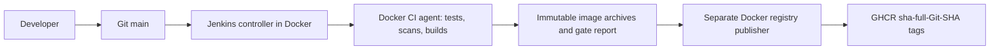

# Phase 1 Jenkins: Docker CI and GHCR

Jenkins runs on the host in Docker Compose, separate from Kubernetes. The controller has zero executors and no cloud agents. A permanent Docker agent builds and scans images; another permanent Docker agent can only publish reviewed CI archives to GHCR. Neither agent has a kubeconfig, a Kubernetes service account, nor a deployment stage.



The reviewed pipeline source is [Jenkinsfile](../../Jenkinsfile) for `app-ci/main` and [Jenkinsfile.promote](../../Jenkinsfile.promote) for `trusted/publish`. JCasC and Job DSL load those local files at controller startup; regular CI source is checked out from the public repository's `main`. Changes must be committed to that branch before a Jenkins SCM checkout can execute them. Until then, use the local `python3 ci/phase1.py all` validation.

## Start and verify

From the repository root:

```bash
python3 infra/jenkins-host/scripts/bootstrap-phase1-jenkins.py
python3 infra/jenkins-host/scripts/verify-phase1-jenkins.py
```

The bootstrap builds digest-pinned controller and agent images, backs up the old persistent Jenkins home before migration, retains old containers with a `-pre-phase1` suffix, installs the locked plugin set, and starts the new Compose stack. It is safe to rerun after an interrupted start. The private home archive is under ignored `.jenkins-host/backups/` with mode 0600. Store an encrypted copy off host as part of normal operations; host-local storage alone does not cover disk failure. No cluster resource is changed.

The UI is at `http://liora.aprt.info:8085/` (the Proxmox host forwards that port to the VM's private address 192.168.77.100) and at `http://127.0.0.1:8085/` on the VM itself. **It is plain HTTP**: the login travels unencrypted, so use a long unique password and prefer an SSH tunnel to port 8085 on untrusted networks. Restrict the Proxmox port forward to the team's addresses where possible; a TLS proxy in front of Jenkins is the planned replacement. Only `admin` has any permission; anonymous users see nothing. Login is `admin`; the password is stored only in ignored `.jenkins-host/secrets/jenkins-admin-password` with mode 0600. Agent identities are generated from Jenkins and stored in separate private mode 0600 files.

The persistent named volumes hold Jenkins home, agent workspaces, the Docker build cache, and DinD TLS certificates. Container recreation and host restart retain them. For a planned upgrade, stop new jobs, wait for running builds, take a consistent Jenkins-home archive, then recreate the controller with Compose. Never delete the home volume to fix startup. A previous controller/container is retained by the bootstrap for rollback, but restoring a prior Jenkins core requires restoring the matching pre-migration home archive too.

## Credentials and trust

The registry credential lives in the Credentials Store of the protected `trusted` folder and is defined by `jobs.groovy` from two controller-only Docker secrets. Job DSL regenerates the folder on every controller start, so a credential added only in the UI is lost on recreation; do not add it by hand.

| ID | Type | Source |
| --- | --- | --- |
| `ghcr-write` | Username with password | `.jenkins-host/secrets/ghcr-write-username` (GitHub account) and `.jenkins-host/secrets/ghcr-write-token` (classic token with `write:packages` for `ghcr.io/fastapi-traefik-devops`), both mode 0600 and ignored by Git |

Create both files before the first `up`; Compose refuses to start the controller without them. Write them without echoing the token, for example `umask 077; read -rs TOKEN; printf '%s' "$TOKEN" > .jenkins-host/secrets/ghcr-write-token; unset TOKEN`.

### After recreating the controller

1. Login uses the current value of `.jenkins-host/secrets/jenkins-admin-password`; JCasC applies it on every start.
2. `trusted/publish` runs outside the sandbox, so a changed `Jenkinsfile.promote` waits in *Manage Jenkins → In-process Script Approval* until an administrator reviews and approves it.
3. A job whose parameters were (re)defined needs one run before *Build with Parameters* appears.
4. Check that `trusted → Credentials` lists `ghcr-write`.

The token is not generated, stored in Git, or passed to the CI build agent. Jenkins injects it only during the trusted publisher stage. On this host the existing Docker GHCR credential was reused with the owner’s authorization, its backend push permission was verified, and it was imported directly into `trusted/ghcr-write` without logging its value. The pipeline itself does not read host Docker credentials. The publisher validates the exact successful `app-ci/main` build number, Jenkins Git revision, all required gate names, source SHA, and both Docker archive hashes before authenticating. Existing SHA tags with different digests are refused; matching tags are idempotent. Both component tags use `sha-` followed by the full 40-character Git SHA. A failed publisher job needs attention even if its source CI build passed.

Only CI administrators may configure/replay the trusted job or manage its credentials. Do not grant arbitrary users Job/Configure or Job/Replay. The CI agent uses an isolated TLS Docker-in-Docker daemon and no host Docker socket. DinD alone needs `privileged` because it creates nested containers; it runs on a dedicated trusted CI host without production credentials. The controller, CI agent, publisher, backend runtime, and frontend runtime are non-root. Do not run untrusted public PR code on this persistent privileged build host. The publisher has neither the Docker build network nor the Docker client certificates.

## Gates

`app-ci/main` performs checkout; backend locked dependencies, mypy/Ruff, unit and API/integration tests; frontend `npm ci`, Biome, Vite/TypeScript, Playwright; `pip-audit`, `npm audit`, Gitleaks for Git history and the current tracked/untracked tree; backend and frontend Docker builds and isolated non-root health smokes; Trivy vulnerability and secret scans for both images; and CI artifact attestation. Each command is mandatory and exits nonzero on failure. Python dependency findings fail the gate; npm High/Critical findings fail; Trivy High/Critical and image secret findings fail. There are no blanket scanner ignores. The exact reviewed exceptions in `.gitleaks.toml` and `.gitleaksignore` cover public plugin versions, encrypted SealedSecret ciphertext and historical demo tokens only.

Tests use generated private disposable CI credentials, an isolated PostgreSQL container, and Mailpit. They publish no host ports. CI private files, reports, workspace artifacts and tools are ignored by Git. JUnit, coverage, dependency and image scan reports are archived by Jenkins. Failed tests/scans stop before attestation or publishing. The publisher never executes code from CI image archives.

Local validation uses the same runner:

```bash
python3 ci/phase1.py all
```

The runner cleans only its own named temporary CI containers/network. It never applies Terraform, touches the Kubernetes cluster, deploys applications, or writes Git. Backend runtime and frontend nginx images retain the ports and paths expected by the existing deployment manifests; those manifests are outside Phase 1.

## Operational limits

The controller is capped at 768 MiB, the CI agent at 384 MiB, the publisher at 512 MiB, and DinD with all nested build containers at 2560 MiB. One executor runs on each Docker agent. Browser tests use the built Vite preview on the isolated CI network to avoid repeated development-server compilation. Verify disk space and Docker volumes periodically; retained image archives can be large. Phase 1 was verified end to end on 2026-10-14: `app-ci/main` #6 passed all gates and `trusted/publish` pushed and verified both `sha-d0a01c5…` images in GHCR.

## Infrastructure tool security builds

The application backend remains Python. Go is used only inside disposable build stages for the existing infrastructure tools. Official source tags and archive SHA256 values are pinned in `tools.lock.json`; the Go compiler image is pinned by digest. Compatible fixed dependency versions are explicit in the lock file. The final agent and daemon images contain the binaries, without the compiler or source tree. `ci/audit_ci_images.py` scans controller, agent and DinD images sequentially; High/Critical findings stop bootstrap before container migration.
